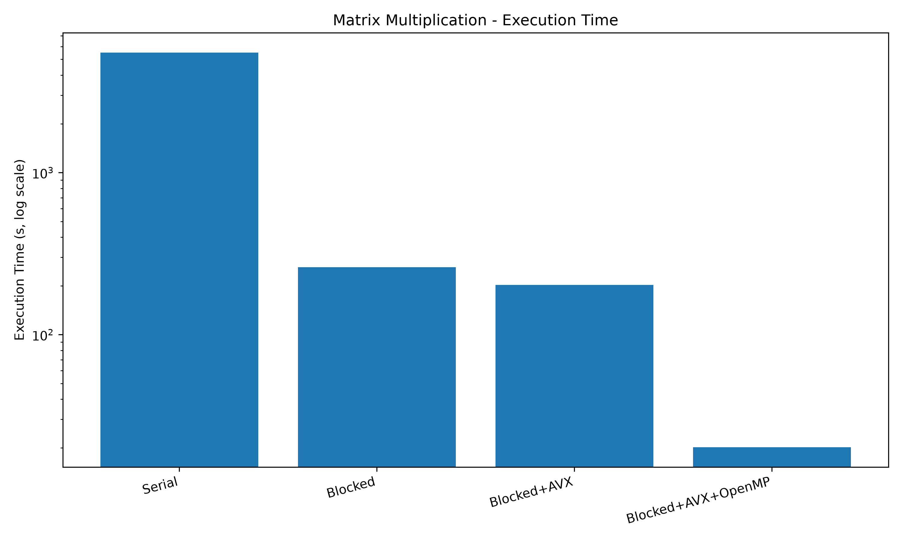

# CPU Matrix Multiplication Optimization

**从串行基准到缓存分块、AVX 向量化与 OpenMP 并行，再到多级分块和手写微内核的 CPU 矩阵乘法研究。**

本项目围绕单精度稠密矩阵乘法 `C = A × B` 展开，研究同一个计算任务如何通过算法实现、数据布局和硬件资源利用逐步降低运行时间。项目包含 C 语言实现、参数实验、CSV 数据、Python 绘图以及按研究顺序组织的技术分析文档。

研究分为两个阶段：第一阶段建立串行、分块、向量化和多线程版本，比较优化效果；第二阶段围绕 `Matrix_mul.c` 的高性能实现，分析多级缓存、B Packing、AVX 4×16 微内核、线程私有缓冲区和 NUMA 访问特征，将性能现象进一步落实到代码结构与硬件机制。

[研究文档目录](docs/Part00_研究过程目录.md) · [核心实现](src/original/Matrix_mul.c) · [历史性能对比](Part1-Experimental-Optimization/05-Performance-Comparison/notes/performance_comparison.md) · [服务器运行记录](Part2-High-Performance-Implementation/docs/Part09_服务器原版运行数据记录.md)

## 1. 研究目标与技术路线

核心问题是：在矩阵乘法的计算量基本不变时，怎样减少数据访问成本、增加每条指令完成的计算量，并有效利用多个 CPU 核心？

```text
建立串行基准
    ↓ 分析行优先存储与循环访问模式
Cache Blocking：调整工作集与缓存的关系
    ↓ 扫描分块参数，观察性能变化
AVX SIMD：一次处理多个单精度元素
    ↓ 分析向量加载、广播、乘加与尾部处理
OpenMP：划分独立输出块，测试线程扩展性
    ↓ 结合各版本数据评估优化收益
自定义高性能实现：多级分块 + B Packing + AVX 4×16 微内核
    ↓ 结合双路 CPU、缓存和 NUMA 拓扑分析
识别重复 Packing 等问题，提出假设并记录验证边界
```

矩阵元素由给定种子生成，程序最终输出结果矩阵的迹 `Trace = Σ C[i][i]`。Trace 用于观察不同运行或版本的结果是否一致，但不能替代完整矩阵的逐元素正确性验证。

## 2. 第一阶段：建立可比较的优化实验

### 2.1 串行基准：理解计算与访存开销

在 [matrix_test.c](src/original/matrix_test.c) 中实现经典 `i-j-k` 三重循环，完成矩阵生成、动态内存分配、矩阵乘法、Trace 汇总和计算阶段计时。

按 N=512、1024、2048、4096、8192 记录规模变化，建立后续优化的参考。行优先存储下，内层循环对 B 的跨行访问是分析局部性的起点；规模增大后的耗时变化也用于讨论计算量与缓存行为的共同影响。

### 2.2 Cache Blocking：用参数实验检验缓存假设

在 [matrix_block.c](src/original/matrix_block.c) 中采用分块循环，将计算限制在较小的子矩阵工作集内，并在块内使用 `i-k-j` 顺序，使 B 和 C 的访问沿行展开。实现通过边界裁剪支持不足一个完整块的尾部区域。

该分块版本也包含 OpenMP 并行，因此历史数据反映对应配置的整体表现，不能把全部收益解释为单独的缓存效应。

研究重点包括：

- 从单精度元素大小和缓存容量估算工作集。
- 扫描 32、64、128、256、512 等分块大小。
- 比较理论起点与实测最佳参数，分析多线程共享缓存的影响。

历史分块实验中，块大小 256 对应最低耗时 **25.928071 秒**；增至 512 后上升到 **81.679690 秒**。这支持了“分块参数需要实验确定”的结论；具体缓存未命中原因仍需硬件计数器验证。

### 2.3 AVX SIMD：显式向量化计算

在 [matrix_avx.c](src/original/matrix_avx.c) 中使用 AVX intrinsics：广播 A 的标量元素，一次读取 B、C 的 8 个连续 `float`，执行向量乘法和加法，再写回结果；不足 8 个元素的部分由标量循环处理。

这一阶段既实现向量化，也关注向量加载、存储和循环控制对整体性能的限制。历史 SIMD 对照数据由 **25.928071 秒**降至 **20.161636 秒**，约 **1.29 倍**加速；8 路浮点向量宽度并不等于程序整体获得 8 倍加速。

### 2.4 OpenMP：任务划分与线程扩展性

第一阶段的分块和 AVX 版本通过 `parallel for collapse(2) schedule(static)` 将输出块分配给线程。程序使用命令行线程参数调用 `omp_set_num_threads()`，便于改变并行度。

历史报告记录了 1、2、4、8、16 线程数据，并在结论及总体比较表中补充了 12 线程结果：

| 线程数 | 执行时间 / 秒 | 报告加速比 |
|---:|---:|---:|
| 1 | 202.617213 | 1.00 |
| 2 | 101.286759 | 2.00 |
| 4 | 55.552043 | 3.65 |
| 8 | 28.364944 | 7.14 |
| 12 | 20.161636 | 10.05 |
| 16 | 55.939662 | 3.62 |

12 线程数据来自报告结论及总体比较表，其余来自原报告表 2-2，来源在文档中分别标注。16 线程未获得更好结果，说明需要结合物理核心、逻辑线程、缓存竞争和调度开销解释扩展性，而非只增加线程数。

### 2.5 总体比较与算法扩展分析

以下是原实验报告总体性能表的记录，完整 CSV 与绘图脚本保存在 [性能比较目录](Part1-Experimental-Optimization/05-Performance-Comparison/)。

| 历史实验版本 | 执行时间 / 秒 | 报告加速比 | 报告 GFLOPS |
|---|---:|---:|---:|
| Serial | 5510.266554 | 1.00 | 0.20 |
| Blocked | 260.358425 | 21.16 | 4.22 |
| Blocked + AVX | 202.617213 | 27.20 | 5.43 |
| Blocked + AVX + OpenMP | 20.161636 | 273.30 | 54.53 |

**该历史总体表记录了相对串行版本 273.30 倍的加速。** 表中结果与前述分块、SIMD 专项实验具有不同的比较配置，按原始来源保留，不串联推算各项技术的独立贡献。



此外，项目分析了 Strassen 的七次子矩阵乘法构造及递推式 `T(N)=7T(N/2)+O(N²)`，讨论其约 `O(N^2.807)` 的复杂度。该部分是算法分析，未列为已实现或已实测版本。

## 3. 第二阶段：分析自定义高性能实现

[Matrix_mul.c](src/original/Matrix_mul.c) 将数据布局、微内核和线程任务组织结合起来。它计算局部结果块并提取对角线，不长期保存完整 C 矩阵。

| 实现模块 | 源码中的设计 | 研究关注点 |
|---|---|---|
| 多级分块 | MC=64、NC=128、KC=256 | 工作集大小、复用范围与任务粒度 |
| B Packing | 按 NR=16 列面板组织数据 | 连续访问、对齐与重复打包成本 |
| AVX 微内核 | MR=4、NR=16，8 个向量累加器 | 寄存器内累加与 B 数据跨行复用 |
| 边界处理 | 列尾部补零，剩余行由 `kern_edge` 处理 | 非整块尺寸的计算路径 |
| 内存分配 | `posix_memalign`，64 字节对齐 | 对齐访问与缓冲区布局 |
| 并行任务 | 输出块展平，`schedule(dynamic, 1)` | 任务调度与负载分配 |
| 线程缓冲 | 每线程独立 Bp、Ct | 避免线程共同写入局部计算缓冲区 |
| 结果汇总 | 各块提取对角线，最后计算 Trace | 减少完整结果矩阵的存储需求 |

### 3.1 从内核指令到整体数据流

`kern4x16()` 每次处理 4 行、16 列：读取两组 256-bit B 向量，将四行 A 中的标量分别广播到向量寄存器，再更新八个累加器。同一组 B 向量用于四行计算，结果在寄存器中累加后写回 Ct。

源码使用显式 AVX 乘法与加法，而不是依赖 AVX2 或 FMA 指令。分析从这些具体操作出发，连接向量宽度、寄存器数量、面板布局和分块参数。

### 3.2 将程序设计与硬件环境联系起来

第二阶段环境文档记录的目标服务器为双路 Intel Xeon E5-2620，12 个物理核心、24 个逻辑线程、两个 NUMA 节点，支持 AVX；软件环境记录为 CentOS 6.10、GCC 7.1.0。

研究围绕 L1/L2/L3 缓存容量、每路 CPU 的缓存共享范围和跨 NUMA 节点访问展开。特别关注 A、B 串行初始化以及线程私有缓冲区的访问方式可能带来的页面放置差异。NUMA 影响在这里属于分析问题，尚不作为经过独立测量的性能结论。

### 3.3 从源码证据提出优化假设

通过检查循环结构，发现 B Packing 位于输出块任务内部，但 B 面板只依赖列块和 K 块，与输出行块无关。因此不同输出行块会重复打包相同 B 数据。

在 N=8192、MC=64 时，共有 128 个输出行块。按源码结构计算，累计 Bp 打包写入量约为 **32 GiB**；这是逻辑写入量，不等于实际 DRAM 流量。

基于该观察，研究提出过 G=2 行块分组复用方案，并保留了设计与历史本地验证记录。服务器上的独立复用版本被手动中断，没有可用于比较的完成耗时，因此没有声称该方案带来性能提升。当前停止这一优化方向，仓库保留原始实现和已有研究记录。

## 4. 服务器运行记录

后续对原始 `Matrix_mul.c` 的服务器运行采用命令：

```bash
time ./matrix_original 8192 0.3
```

| 次数 | Trace | real / 秒 | user / 秒 | sys / 秒 |
|---:|---:|---:|---:|---:|
| 1 | 16165611.000000 | 6.436 | 68.153 | 0.139 |
| 2 | 16165611.000000 | 6.440 | 68.198 | 0.135 |
| 3 | 16165611.000000 | 6.434 | 68.121 | 0.138 |

三次 Trace 一致；`real` 平均值为 **6.436667 秒**，中位数为 **6.436 秒**。

这里的 `real` 是整个进程的墙钟耗时，包含初始化等开销；`user` 是累计用户态 CPU 时间。截图未完整记录编译参数、线程数、绑定方式和系统负载，所以这组数据单独保存，**不与第一阶段数据直接计算加速比**。

## 5. 项目体现的研究与工程实践

- **从可运行基准出发。** 用明确的输入、计算和输出流程建立参考，再逐步引入优化技术。
- **将假设转化为参数实验。** 扫描矩阵规模、分块大小和线程数，用数据判断参数效果，并讨论与理论估算的偏差。
- **落实到底层 C 实现。** 使用动态内存、对齐分配、AVX intrinsics、OpenMP 调度、Packing 布局与边界内核组织计算。
- **跨层分析性能。** 将循环访问模式、缓存工作集、寄存器复用、多线程和 NUMA 拓扑联系起来。
- **保留可追溯的实验材料。** 使用 CSV 保存历史数据，Python 脚本生成图表，Markdown 记录实验条件、分析过程与结论边界。
- **区分假设与证据。** 不将理论数据移动量当作实测内存流量，不将本地 Trace 检查当作目标服务器性能验证，也不为未完成的尝试填写加速比。

## 6. 仓库结构与阅读顺序

```text
CPU-Matrix-Multiplication-Optimization/
├── src/original/                       # 当前保留的原始 C 源码
├── Part1-Experimental-Optimization/
│   ├── 01-Baseline/                    # 串行基准
│   ├── 02-Cache-Blocking/              # 分块实验、数据与图表
│   ├── 03-SIMD-AVX/                    # AVX 分析与实验
│   ├── 04-OpenMP/                      # 线程扩展性实验
│   ├── 05-Performance-Comparison/      # 历史总体比较
│   ├── 06-Strassen-Analysis/           # 算法与复杂度分析
│   └── source/original/                # 第一阶段源码归档
├── Part2-High-Performance-Implementation/
│   ├── docs/                          # 按研究顺序编号的技术文档
│   └── source/original/                # Matrix_mul.c 归档
├── docs/                              # 研究导航与历史验证记录
├── exiperiment-environment/            # 环境记录，保留已有目录名
└── tests/                             # 历史检查脚本
```

建议先阅读第一阶段各章的 `notes`，理解优化实验，再按第二阶段文档顺序阅读：**环境 → 架构 → 分块 → Packing → AVX → OpenMP/NUMA → 瓶颈 → 复用方案 → 运行记录**。入口见 [研究过程目录](docs/Part00_研究过程目录.md)。

## 7. 编译与运行

以下命令在项目根目录执行，要求 Linux、支持 AVX 的 x86 CPU，以及支持 OpenMP 的 GCC。这些是使用示例，不是对历史实验编译参数的追认。

```bash
# 串行基准：参数为 N、seed
gcc -O3 -std=gnu99 src/original/matrix_test.c -o matrix_serial
./matrix_serial 512 0.3

# 分块版本：参数为 N、seed、block_size、threads
gcc -O3 -std=gnu99 -fopenmp src/original/matrix_block.c -o matrix_block
./matrix_block 512 0.3 64 4

# AVX 版本：参数为 N、seed、block_size、threads
gcc -O3 -std=gnu99 -mavx -fopenmp src/original/matrix_avx.c -o matrix_avx
./matrix_avx 512 0.3 64 4

# 高性能原版：线程数由 OpenMP 环境变量控制
gcc -O3 -std=gnu99 -mavx -fopenmp -ffp-contract=off \
    src/original/Matrix_mul.c -o matrix_original
OMP_NUM_THREADS=4 ./matrix_original 512 0.3
```

前三个版本在程序内输出计算时间；`Matrix_mul.c` 只输出 Trace。如用 `time` 测量后者，记录的是整个程序耗时，不能直接视作同一计时范围。

绘图脚本使用 Python 3 和 Matplotlib，例如：

```bash
python3 -m pip install matplotlib
python3 Part1-Experimental-Optimization/04-OpenMP/plot_openmp.py
```

绘图脚本根据已有 CSV 生成图表，不会重新执行矩阵性能实验。

## 8. 当前状态与实验边界

原始源码作为研究成果保留，当前工作以文档整理和真实实验数据记录为主，不再继续修改内核。

- 历史课程实验数据、后续服务器运行记录分别保存；不同环境和计时范围的数据不混合计算加速比。
- Strassen 为理论分析，未提供实测实现。
- G=2 Packing 复用为已暂停的尝试，不列为已验证的性能成果。
- `tests/check_packing_reuse.py` 为历史检查脚本；当前仓库不含其依赖的独立复用源码，不能作为开箱即用的测试入口。
- 已清理空目录。源码、实验数据、图表和研究文档均保留。

数据来源与详细条件以各章节记录为准。
